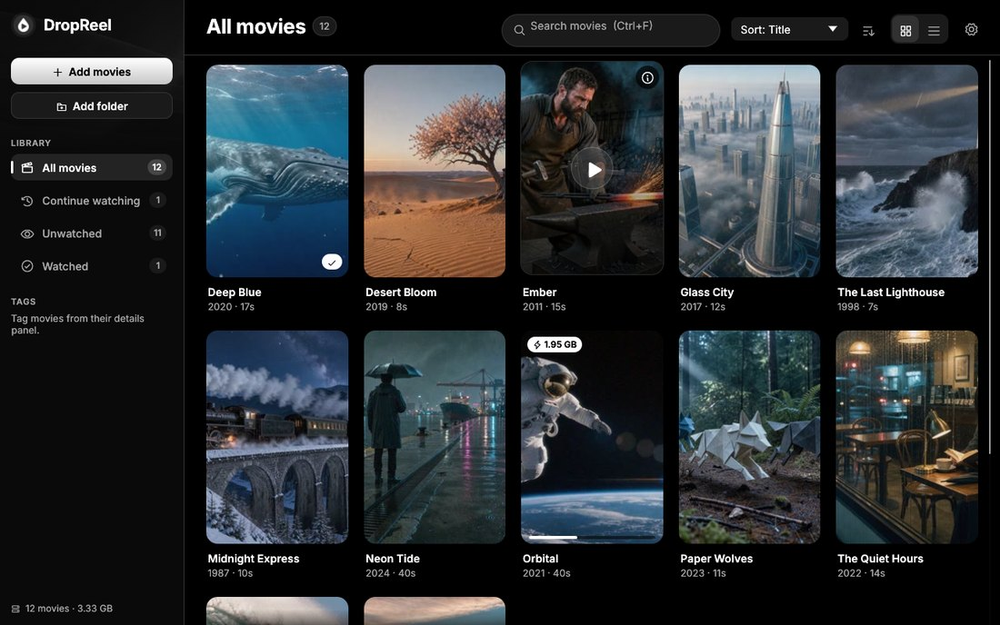
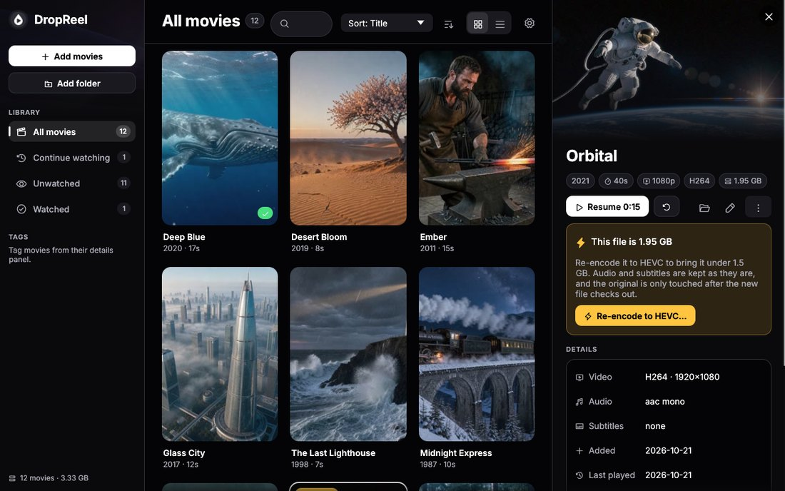
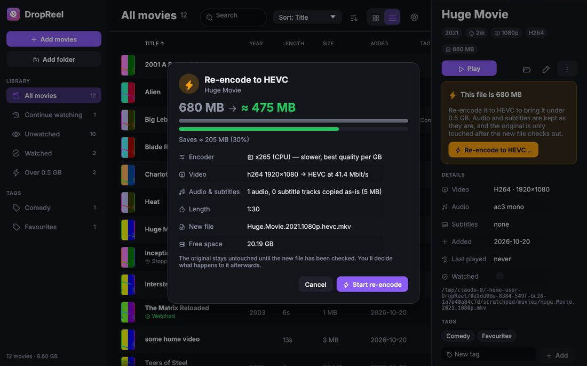
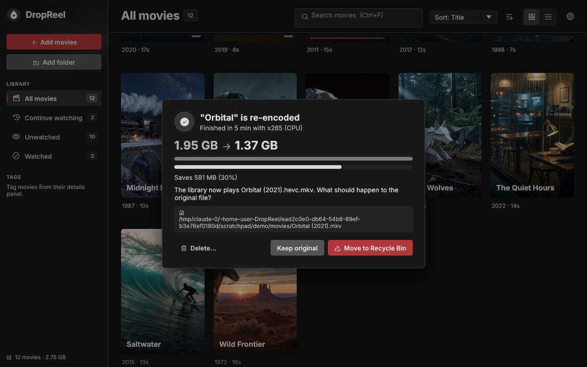
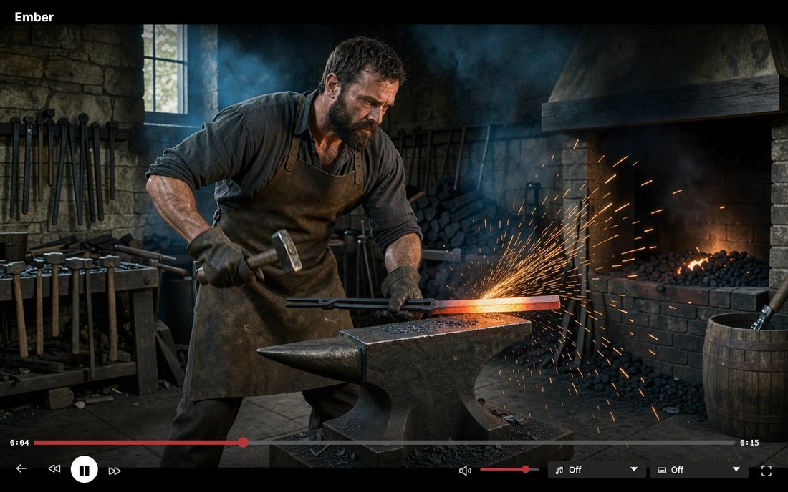
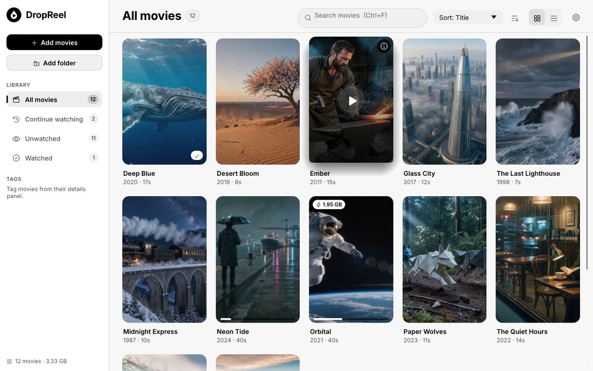
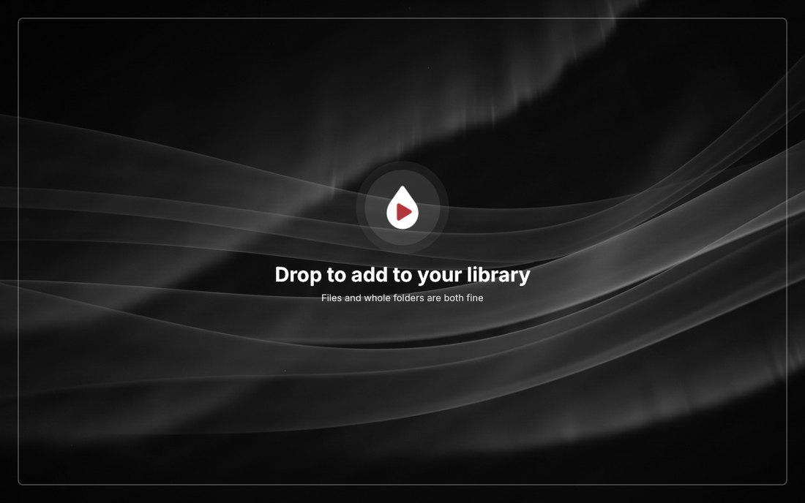

<p align="center"></p>

# Dropreel

[](https://github.com/Alister-o7/DropReel/actions/workflows/windows.yml)

A movie and TV library and player for Windows, written in Rust. Drag movie or episode files, or
whole folders, onto the window and they join your library; click a poster and it plays right
there. Files larger than 5 GB get a one-click re-encode to HEVC that brings them under 5 GB.



## Features

- **Drag & drop library** — drop files or whole folders (`mkv mp4 m4v avi mov wmv webm ts m2ts`).
  Duplicates are skipped, and a movie that was moved or renamed is found again by its
  fingerprint. Watched folders import new movies automatically.
- **Shows** — files named like episodes (`Show.Name.S01E02.mkv`, `Show Name - 1x02 - Title.mkv`,
  or `S01E02.mkv` inside a `Show Name/Season 1` folder) become one show with seasons and
  episodes. Its poster opens the episode list; its ▶ button picks up the episode you're on, or
  the next one. In an episode's last minute an *Up next* card plays the next one after a few
  seconds, and `N` skips ahead. With a TMDb key, shows get
  their poster, plot and episode titles.
- **Built-in player** (libmpv) — the video fills the window and the controls float over it,
  fading once the mouse rests (after 2.5 s by default, adjustable, paused or not). The time
  shows as the time left (the default), or as time played and length. Seek bar, audio and
  subtitle tracks, volume, fullscreen, keyboard shortcuts, and **resume** where you left off.
  Movies are marked watched at 95%.
- **Re-encode to HEVC** — for files over the limit (5 GB by default): a preview with the
  expected size, then a background encode with progress, ETA and cancel. The size it aims for
  follows the limit (95% of it, so 4.75 GB for 5 GB). Two quality presets: **Best quality**
  (the default) uses x265 at its slow preset in 10-bit, sharper at the same size but much
  slower; **Fast** uses your GPU (NVENC → AMF → Quick Sync) when available, otherwise x265.
  *Custom* lets you pick the encoder and x265 preset yourself. Audio and subtitles are copied
  untouched, HDR10 metadata is kept, and the result is verified before the original is touched.
  Afterwards you choose: keep the original, move it to the Recycle Bin, or delete it.
- **Organise** — poster grid or list with a featured banner for what you were last watching (or
  the newest addition), search, sort, shelves (Movies, Shows, Continue watching, Unwatched,
  Watched…) and your own tags, which you can rename, merge and delete.
- **Posters & metadata** — a frame from the movie by default (up to 1280 px wide, with the title
  across the bottom like box art); optionally 780-pixel posters from
  [TMDb](https://www.themoviedb.org) with an API key. Works fully offline.
- **A dark, Netflix-style look** with one brick-red accent, plus a light theme.

| Movie details | Re-encode preview |
|---|---|
|  |  |
| **Re-encode finished** | **Player** |
|  |  |
| **Light theme** | **Drop to add** |
|  |  |

## Install

Download the latest version from the
[Releases page](https://github.com/Alister-o7/DropReel/releases/latest): either the installer
(`Dropreel-<version>-setup.exe`, per-user, no admin needed) or the portable zip. Windows 10/11,
64-bit. Builds of every commit are also available as the **Dropreel-win64** artifact on the
[Actions page](https://github.com/Alister-o7/DropReel/actions/workflows/windows.yml).

To publish a new release, bump `version` in `Cargo.toml`, add
`docs/release-notes/v<version>.md`, then either push a `v<version>` tag or run the **Windows**
workflow manually with *Publish a GitHub Release* ticked. CI builds, tests, creates the tag and
attaches the installer, zip and checksums to a GitHub Release.

Keep these files next to `Dropreel.exe` (both packages include them):

| File | What it's for | Without it |
|---|---|---|
| `libmpv-2.dll` | Playing movies inside Dropreel | Movies open in your default player instead |
| `ffprobe.exe` | Durations, codecs, tracks | Movies are added without technical details |
| `ffmpeg.exe` | Thumbnails and re-encoding | No frame posters, no re-encoding |
| `av*.dll`, `sw*.dll` | FFmpeg libraries used by `ffmpeg.exe`/`ffprobe.exe` | Neither tool starts |

You can also point Dropreel at your own `ffmpeg`/`ffprobe` in **Settings**, or have them on `PATH`.

## Using Dropreel

| Action | How |
|---|---|
| Add movies | Drag files/folders onto the window, or **Add movies** / **Add folder** |
| Play | The ▶ button in the middle of a poster (or double-click a row in list view) |
| Details, tags, re-encode · a show's episodes | Click a poster, or right-click it |
| Rename or delete a tag | Right-click it in the sidebar, or *Settings → Tags* |
| Play/pause · seek ±10 s · volume · mute | `Space` · `←` `→` · `↑` `↓` · `M` |
| Next episode | `N`, or the ⏭ button |
| Fullscreen | `F` or double-click the video; `Esc` leaves fullscreen, then returns to the library |
| Search | `Ctrl+F` |
| Player settings | The ⚙ button at the top right of the player |

### As your video player

The installer adds Dropreel to Explorer's **Open with** menu for video files and lists it under
**Settings → Apps → Default apps**, so it can be your default video player (the
**Choose default video player…** button in the player settings takes you there). It doesn't
take over any file type by itself.

A video opened from Explorer just plays: it isn't added to the library, and closing the player
(`Esc`, or the ✕ button) closes Dropreel when it was started for that video. A video that's
already in your library plays from there, from where you stopped. To have opened videos added
to the library instead, choose **Videos opened from Explorer → Add them to the library** in the
player settings.

Only one Dropreel runs at a time: opening another video while it's running plays that video in
the window that's already open.

Data lives in `%APPDATA%\Dropreel`: `library.db` (SQLite), `settings.toml`, `cache\posters`
and `logs`.

### Troubleshooting

- **Black picture but sound plays** — turn off *Settings → Player → High-quality video
  scaling*. On software OpenGL (VMs, remote desktop) simple scaling is used automatically.
- **Choppy or juddery playback** — try *Settings → Player → Smooth motion* (off by default): it
  syncs video to your monitor's refresh rate and blends frames. Each playback writes a
  `playback stats:` line to the log (decoder, dropped/late frames, render times) — attach it to a
  bug report.
- **mpv diagnostics** — set `DROPREEL_MPV_LOG=C:\path\mpv.log` before starting Dropreel to get
  mpv's own log; `DROPREEL_MPV_OPTS="hwdec=no,scale=bilinear"` passes extra mpv options.
- **Re-encode didn't fit under the limit** — GPU encoders aim close to the target but can
  overshoot slightly; choose *Best quality* (or *Custom* with x265) in Settings for the most
  accurate size.
- Logs are in `%APPDATA%\Dropreel\logs`. Set `DROPREEL_LOG=debug` for more detail.

## Building from source

Requirements: [Rust](https://rustup.rs) (stable, MSVC toolchain), PowerShell, and 7-Zip or
the `tar.exe` that ships with Windows 10+.

```powershell
git clone https://github.com/Alister-o7/DropReel
cd DropReel
.\packaging\package.ps1            # download libmpv + ffmpeg, build, and package
```

The script's stages can also run separately: `-Stage deps` (download the third-party binaries
into `packaging\deps`), `-Stage build` (`cargo build --release`) and `-Stage package`
(assemble `dist\Dropreel\`, zip it, and build the installer if
[Inno Setup 6](https://jrsoftware.org/isinfo.php) is installed).

For development, `cargo run` works once `libmpv-2.dll`, `ffmpeg.exe` and `ffprobe.exe` are
next to the built exe or on `PATH` (e.g. `$env:PATH = "$PWD\packaging\deps;$env:PATH"`).
Set `DROPREEL_HOME` to use a separate data folder while trying things out.

### Tests

`cargo test` runs the unit tests and these integration suites. They generate small test clips
with ffmpeg once, and cache them under `target/`.

| Suite | What it covers |
|---|---|
| `tests/library.rs` | Importing every supported container from nested folders, junk and partial files, duplicates, concurrent imports, moved/missing/removed files, Locate…, folder watching, search/sort/shelves/tags, episodes grouped into shows |
| `tests/player.rs` | Real libmpv, headless: loading, resume, pause, seeking (including before a file has finished opening), end of file, truncated files, audio/subtitle tracks, volume, unplayable files, smooth motion |
| `tests/ui.rs` | The whole app driven through its accessibility tree with egui_kittest: drag & drop, search, details, removal, settings, renaming and deleting tags, shows and Up next, toolbar layout at every width, small windows, playback controls, resume prompt, keyboard shortcuts, track menus, the player settings menu, "Open with" (just playing, adding to the library, a video handed over by a later launch) |
| `tests/ffmpeg_pipeline.rs`, `tests/encode_queue.rs` | Probing, thumbnails, real HEVC encodes and verification |

Suites skip themselves when ffmpeg or libmpv can't be found. Point `DROPREEL_LIBMPV` at
`libmpv-2.dll` to run the playback tests. Set `DROPREEL_REQUIRE_FFMPEG=1` and
`DROPREEL_REQUIRE_MPV=1` to make a missing tool fail instead; CI sets both.

### Where the bundled binaries come from

- **libmpv-2.dll** — the latest `mpv-dev-x86_64-*.7z` from
  [shinchiro/mpv-winbuild-cmake](https://github.com/shinchiro/mpv-winbuild-cmake/releases)
  (override with `-MpvDevUrl`).
- **ffmpeg.exe / ffprobe.exe** and their DLLs — `ffmpeg-master-latest-win64-gpl-shared.zip`
  from [BtbN/FFmpeg-Builds](https://github.com/BtbN/FFmpeg-Builds/releases) (override with
  `-FfmpegUrl`; a static build works too). The GPL build includes x264, x265 and the
  NVENC/AMF/QSV encoders; the shared variant keeps the package about half the size.

The exact URLs used are written to `licenses\*.source.txt` in each package.

## Licenses

Dropreel's own code is under the [MIT License](LICENSE).

The packages bundle third-party software under its own licenses — see
[THIRD-PARTY-NOTICES.md](THIRD-PARTY-NOTICES.md):

- **mpv** (`libmpv-2.dll`) — GPLv2+ for these builds (mpv itself can be LGPL; the shinchiro
  builds include GPL parts). Dropreel loads it at run time, so a package containing it is
  distributed under the GPL; Dropreel's MIT license is GPL-compatible and its source is this
  repository.
- **FFmpeg** (`ffmpeg.exe`, `ffprobe.exe` and their DLLs) — GPL (BtbN "gpl-shared" build). Run
  as separate programs.
- **Inter** font — SIL Open Font License 1.1. **Phosphor Icons** — MIT.
- Rust crates — mostly MIT/Apache-2.0; the full list is generated into `licenses\rust-crates.txt`.
