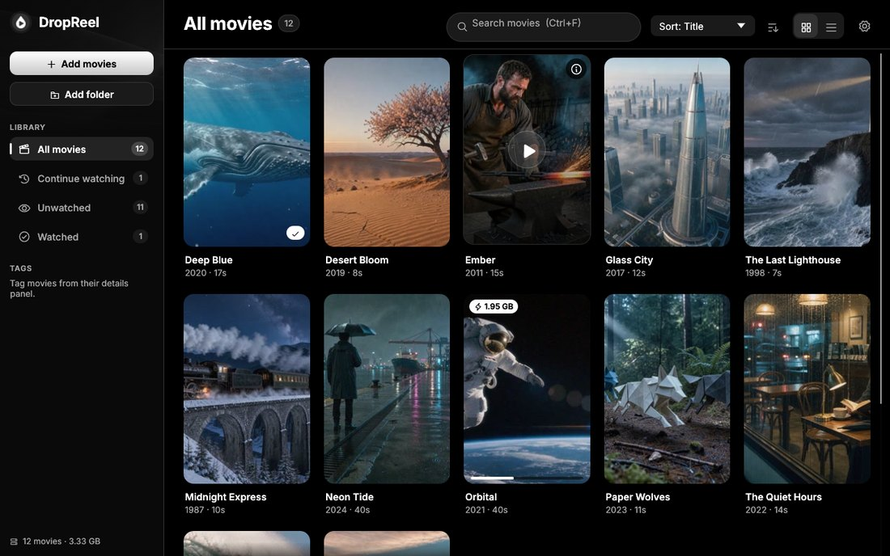

The first release of **DropReel** — a movie library and player for Windows. Drag movies in, click a poster to watch, and shrink anything over 5 GB to HEVC with one click.

## Download

| File | What it is |
|---|---|
| **`DropReel-0.1.0-setup.exe`** | Installer (recommended). Installs for your user without admin rights, adds a Start-menu shortcut and **Open with → DropReel** for video files, and can be uninstalled from Settings → Apps. |
| `DropReel-0.1.0-win64.zip` | Portable version — unzip anywhere and run `DropReel.exe`. |
| `SHA256SUMS.txt` | Checksums for both downloads. |

Requires 64-bit Windows 10 or 11. Windows SmartScreen may warn because the files aren't code-signed — choose **More info → Run anyway**.

## What's in it

- **Drag & drop library** — files or whole folders; duplicates are skipped and moved/renamed movies are found again. Watched folders import new movies automatically.
- **Built-in player** (mpv) — seek bar, audio and subtitle tracks, volume, fullscreen, keyboard shortcuts, and resume where you left off.
- **Re-encode to HEVC** for files over 5 GB — see the expected size first, then encode in the background with progress and cancel. Uses your NVIDIA/AMD/Intel GPU when available, otherwise x265. Audio, subtitles and HDR10 metadata are kept, the result is verified, and you decide what happens to the original (keep, Recycle Bin or delete).
- **Organise** — poster grid or list, search, sort, shelves (Continue watching, Unwatched, Large files…) and tags.
- **Posters** from a frame of the movie, or from TMDb with an optional API key. Works offline.
- Dark and light themes.

## Good to know

- Your library and settings are stored in `%APPDATA%\DropReel`.
- If a movie plays with sound but a black picture, turn off **Settings → Player → High-quality video scaling**.
- GPU encoders can land slightly off the target size; choose **x265 (CPU)** in Settings for the most accurate result.

## Licenses

DropReel is MIT-licensed. The packages include mpv (`libmpv-2.dll`) and FFmpeg (`ffmpeg.exe`, `ffprobe.exe` and their DLLs) under the GPL, plus the Inter font (OFL) and Phosphor icons (MIT). Details and source links are in the `licenses` folder and [THIRD-PARTY-NOTICES.md](https://github.com/Alister-o7/DropReel/blob/v0.1.0/THIRD-PARTY-NOTICES.md).
