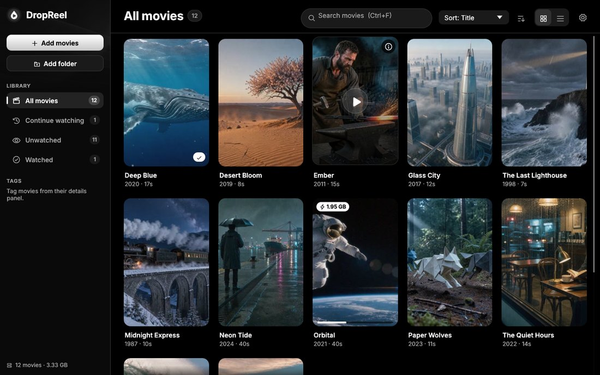

A new look for DropReel: a new logo, a darker Netflix-style interface, a featured banner, sharper posters and a cleaner player.

## What's new

- **New logo.** A white droplet with a brick-red play button on a dark tile, for the app, the taskbar and the installer.
- **New look.** A near-black interface with soft-white text and one brick-red accent for primary buttons, progress and the current shelf. Corners are tighter and buttons flatter. The light theme gets the same treatment.
- **Featured banner.** *All movies* opens with a large banner for the movie you were last watching, or the newest one, with **Resume** / **Play** and **More info**.
- **Titles on frame posters.** Posters made from a frame of the movie now carry the title across the bottom, like box art. TMDb posters are unchanged.
- **Sharper posters.** Frames are now grabbed at up to 1280 pixels wide instead of 480. Posters from earlier versions are upgraded automatically in the background the first time you start 0.2.0.
- **A cleaner player.** The video fills the window and the controls float over it, fading away when the mouse rests, in a window too. Seeking and volume use a thin red slider that grows when you point at it.
- **Smoother.** The details panel slides in and out, posters fade in as they load (with a shimmer while they do), and switching between the library and the player fades through black.
- **Artwork** for the empty library and the drag-and-drop overlay.

## Fixes

- **A rare freeze around the built-in player is fixed.** mpv's wake-up call could wait on the window while the window waited on mpv, hanging DropReel.
- **Seeking right after a movie opens works.** Pressing ← / → or using the seek bar before the file had finished opening was ignored; it's now applied as soon as the movie is ready.
- Icons in buttons, badges and circles are now centred properly; several sat a few pixels low.
- The player's back and rewind buttons lined up a few pixels higher than the others.
- The search box no longer covers the page title when the details panel is open.
- The progress ring on a poster that is being re-encoded is visible on the light theme.

## Download

| File | What it is |
|---|---|
| **`DropReel-0.2.0-setup.exe`** | Installer (recommended). It installs over earlier versions, and your library and settings stay where they are. |
| `DropReel-0.2.0-win64.zip` | Portable version: unzip anywhere and run `DropReel.exe`. |
| `SHA256SUMS.txt` | Checksums for both downloads. |

Requires 64-bit Windows 10 or 11. The files aren't code-signed, so SmartScreen may warn: choose **More info → Run anyway**.
